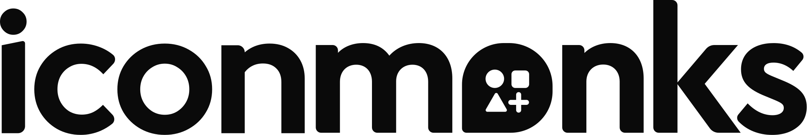

<p align="center">
  <picture>
    <source media="(prefers-color-scheme: dark)" srcset="logo-light.svg">
    
  </picture>
</p>

<p align="center">
  <a href="https://www.npmjs.com/package/@icon-monks/react"></a>
  <a href="https://pub.dev/packages/icon_monks"></a>
  <a href="https://jitpack.io/#designmonks-llc/icon-monks"></a>
  <a href="packages/swift"></a>
  <a href="https://github.com/designmonks-llc/icon-monks/actions/workflows/ci.yml"></a>
  <a href="LICENSE.md"></a>
</p>

# Icon Monks

An open source icon family, a product of [Design Monks](https://monks.company/): **70,000+ icons in 6 weights** (thin, light, regular, bold, fill,
duotone), drawn on a 256-unit grid and generated into native packages for every major platform.
Icons are grouped into 31 categories: animals, arrows, brands, business, charts, commerce, communication, design, development, devices, editor, education, emoji, files, food, health, home, interface, letters & numbers, maps, media, nature, objects, people, science, security, sports, symbols, time, transport, weather.

| Platform | Package | Version | Folder |
| --- | --- | --- | --- |
| SVG, sprites, metadata | `@icon-monks/core` | [](https://www.npmjs.com/package/@icon-monks/core) | [packages/core](packages/core) |
| React | `@icon-monks/react` | [](https://www.npmjs.com/package/@icon-monks/react) | [packages/react](packages/react) |
| Vue 3 | `@icon-monks/vue` | [](https://www.npmjs.com/package/@icon-monks/vue) | [packages/vue](packages/vue) |
| Web Components / CDN | `@icon-monks/web` | [](https://www.npmjs.com/package/@icon-monks/web) | [packages/web](packages/web) |
| Icon font (OTF + WOFF2, CSS) | `@icon-monks/font` | [](https://www.npmjs.com/package/@icon-monks/font) | [packages/font](packages/font) |
| Flutter | `icon_monks` | [](https://pub.dev/packages/icon_monks) | [packages/flutter](packages/flutter) |
| Android (Compose + VectorDrawable) | `com.github.designmonks-llc:icon-monks` (JitPack) | [](https://jitpack.io/#designmonks-llc/icon-monks) | [packages/android](packages/android) |
| iOS / macOS / tvOS / watchOS (SwiftUI + UIKit) | Swift Package `IconMonks` | [](https://github.com/designmonks-llc/icon-monks/releases) | [packages/swift](packages/swift) |

Browse, search and copy icons at **https://www.iconmonks.co/** (built from `docs/template.html` into `index.html`).

```jsx
import { House, Heart } from '@icon-monks/react';
<House size={24} />  <Heart weight="fill" color="crimson" />
```

## How it works

Each icon is one source file in [`icons/`](icons) drawn with plain SVG shapes and a 16-unit stroke. Shapes are grouped by
role, which tells the build how each weight is made:

| Role | Outline weights | Fill weight | Duotone |
| --- | --- | --- | --- |
| `line` | stroked | merged in | stroked |
| `detail` | stroked | cut out | stroked |
| `area` | | merged in | 20% tint |
| `hole` | | cut out | |
| `dot` / `dotcut` | solid dot | merged in / cut out | solid dot |
| `slash` | stroked, with a gap cut around it | stroked, with a gap | stroked, with a gap |
| `badge` | standard corner mark, with a round clearing cut around it | stroked; closed marks filled | stroked, with a clearing |

`scripts/build.py` outlines strokes at 8 / 12 / 16 / 24 units with Skia path ops, so every output is a single flat
path that renders identically in browsers, fonts, Android and Xcode. `scripts/packages.py` turns that into each package.

```sh
pip install skia-pathops fonttools brotli
npm install
npm run build   # svg/, packages/*, index.html
npm test        # package tests (React SSR, Vue SSR, core)
node tests/browser.mjs   # renders the web component, fonts and sprites in Chromium
```

## Contributing an icon

Read [STYLE.md](STYLE.md) first. It has the drawing rules every new icon follows.

1. Copy a similar file in `icons/` and draw inside the 32–224 live area on the 256 grid.
2. Put strokes that should become knock-outs in the fill weight in the `detail` group, and the shape to fill in `area`.
3. Add `data-category` and a few `data-tags` for search, then run `npm run lint`.
4. Run `npm run build` and check the result in `index.html`.

Font codepoints are append-only (`codepoints.json`), so existing glyphs never move.

## Releasing

1. Bump `version` in `package.json`, add a changelog entry in `scripts/packages.py`, run `npm run build` and merge.
2. Create the GitHub release: `gh release create vX.Y.Z --target main --title "Icon Monks vX.Y.Z"`. This tags `main`.
3. The tag runs `.github/workflows/release.yml`, which publishes the npm packages (trusted publishing, no token)
   and the Flutter package (pub.dev automated publishing). Swift Package Manager and JitPack build straight from the tag.

## License

MIT © [Design Monks](https://monks.company/). Icon Monks is a product of Design Monks. The icon designs are original; the project is inspired by the approach of
[Phosphor Icons](https://phosphoricons.com/), but shares no artwork with it.

Icons in the Brands category show logos and products that are trademarks of their owners. The MIT license covers our
drawings, not the trademarks: using a brand's logo is still subject to that brand's own guidelines.
